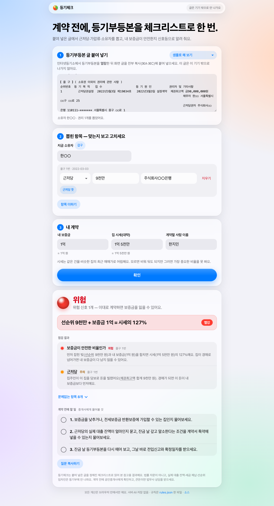
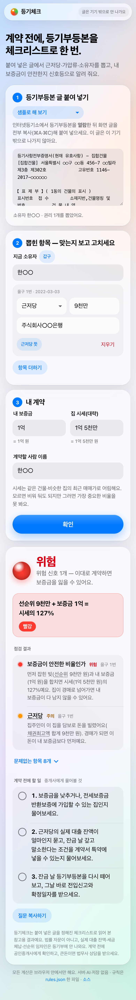
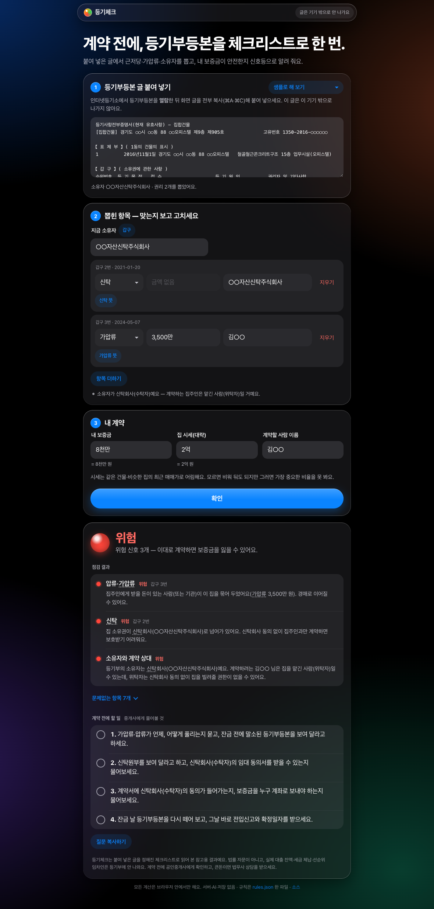

# 등기체크

> 등기부등본의 근저당·가압류 항목을 체크리스트 규칙으로 점검해 계약 직전 위험 신호를 쉬운 말로 알려 주는 웹 도구.



## 문제

처음 계약하는 사회초년생은 계약 직전에 등기부등본을 떼어 봐도 근저당·가압류가 무슨 뜻인지, 내 보증금이 위험한지 판단하지 못한다.

## 어떻게 동작하나

1. **붙여 넣기** — 인터넷등기소에서 열람한 등기부등본 글을 통째로 붙여 넣는다. 버튼 없이 바로 갑구·을구를 읽어 소유자와 권리(근저당·가압류·신탁 …)를 뽑는다. 부기등기(1-1 금액 변경, 1-2 권리자 이전)는 본 등기에 합치고, 말소된 건 뺀다.
2. **고치기** — 뽑힌 칸은 사람이 보고 고친다(파서가 틀릴 수 있어서). 보증금·시세·계약할 사람 이름을 적으면 칸 아래에 `= 1억 5천만 원`처럼 읽은 값이 보인다.
3. **확인** — 규칙 12개가 점검 항목 11개를 평가해 빨강(위험)·노랑(주의)·초록(양호)·회색(모름)으로 나눈다. 이유를 쉬운 말로 쓰고, 계약 전에 중개사에게 물어볼 것을 체크리스트로 준다. '질문 복사하기'로 메신저에 바로 붙일 수 있다.

글은 **이 기기 밖으로 나가지 않는다.** 서버·AI·계정·저장이 없고, 모든 계산은 브라우저 안에서 한다.

| 휴대폰 | 어두운 화면(신탁·가압류 오피스텔) |
|---|---|
|  |  |

## 실행

Node 18+ 또는 Python 3 만 있으면 된다. 설치할 것 없음.

```sh
npm start                 # = python3 -m http.server 8080
# 브라우저에서 http://localhost:8080/app/
```

파일을 더블클릭해 `file://` 로 열면 브라우저가 모듈·JSON 읽기를 막는다 — 꼭 위처럼 띄운다.

## 데모 — 30초 장면

1. `http://localhost:8080/app/` 를 연다.
2. 오른쪽 위 '샘플로 해 보기' → **근저당 있는 빌라 — 데모**를 고른다(또는 `data/scenarios.json` 의 `villa` 글을 복사해 붙여 넣는다).
3. 2단계에 **을구 1번 근저당 9천만**, 소유자 **한○○** 가 뽑혀 나온다.
4. 보증금 `1억`, 시세 `1억 5천만` 을 넣고 **확인**.
5. **선순위 9천만 + 보증금 1억 = 시세의 127% — 빨강**, 그 이유("집이 경매로 넘어가면 내 보증금이 다 남지 않을 수 있어요"), 중개사에게 물어볼 질문 3개가 뜬다.

`http://localhost:8080/app/?demo=villa` 로 열면 4단계까지 한 번에 채워 보여 준다.

이 장면은 `npm run demo:check` 가 진짜 크롬으로 붙여 넣기 → 입력 → '확인'까지 눌러 보고 확인한다(화면은 `demo/*.png`).

## 시험

```sh
npm test              # 핵심 로직 14개 — 파서·규칙엔진·설명(브라우저 없이)
npm run demo:check    # 데모 장면 + 휴대폰 폭·어두운 화면·빈칸 오류·용어 풀이 (크롬 필요)
```

## 규칙 바꾸기

판단 기준과 문장은 전부 [`data/rules.json`](data/rules.json) 한 파일에 있다. 코드를 안 고치고 숫자(예: 비율 80%)나 문장만 바꿀 수 있다. 형식은 [`contracts/README.md`](contracts/README.md).

## 폴더

```
app/        화면 — index.html, style.css(애플 글라스 결)
core/       RegistryParser(등기 글 읽기) · RuleEngine(규칙 평가) · ExplanationBuilder(쉬운 말)
            RuleRepository(JSON 읽기) · CheckFormView · ResultView · App
data/       rules.json(규칙 12 · 항목 11) · glossary.json(용어 13) · scenarios.json(지어낸 등기 4장)
tests/      핵심 로직 시험
demo/       브라우저 데모 확인(check.mjs)과 화면
docs/       DESIGN.md(클래스 설계와 바꾼 것) · HACKATHON.md · MAKING.md(만든 과정)
```

## 한계 — 꼭 읽기

- **법률 자문이 아니다.** 비율 기준 70%·80%는 흔히 쓰는 어림 기준이다(근거와 HUG 기준 비교는 [NOTES.md](NOTES.md)).
- 지어낸 등기부 4장으로만 시험했다. 진짜 열람 글을 복사했을 때의 모양은 아직 확인하지 못했다.
- 등기부에 안 나오는 것(대출 잔액, 먼저 사는 세입자, 세금 체납)은 볼 수 없다.

## 이미 있는 것과 다른 점

세이프홈즈·안심전세 앱 같은 서비스가 이미 등기부 위험을 진단해 준다(시세·임대인 정보까지). 등기체크는 계정·업로드 없이 브라우저 안에서만 돌고, 판단 규칙이 파일 한 장으로 다 보인다. 자세히는 [NOTES.md](NOTES.md).

## 어떻게 만들었나

아이디어 도구 **VYNE** 로 빈 지도에서 주제 하나("첫 자취방 계약")를 뻗어 이 안을 정하고, VYNE 가 만들어 준 [`BUILD_PROMPT.md`](BUILD_PROMPT.md) 대로 Claude Code 로 만들었다. 화면을 한 장씩 찍은 전체 과정과, 쓰면서 VYNE 에서 고친 것: **[docs/MAKING.md](docs/MAKING.md)**

## 라이선스

MIT. `data/scenarios.json` 의 등기부 글은 전부 지어낸 것이다(사람·주소·번호는 ○로 가림).
