# 등기체크를 만든 과정 — 빈 VYNE 에서 돌아가는 앱까지

이 문서는 아이디어 도구 **VYNE** 를 처음부터 써서 앱 하나(등기체크)를 끝까지 만든 기록이다. 모아 둔 아이디어 없이 **빈 지도**에서 시작했고, 화면은 그때 그대로 찍었다. 쓰면서 불편했던 곳은 그 자리에서 VYNE 를 고쳤다 — 고친 목록은 맨 아래에 있다.

## 먼저 낱말 몇 개

| 낱말 | 뜻 |
|---|---|
| VYNE | 주제 하나를 다섯 갈래로 뻗어 아이디어를 정하고, 그 안을 프로젝트 폴더까지 만들어 주는 마인드맵 도구 |
| 갈래 | 주제를 보는 다섯 질문 — 누구를 위해 · 문제 · 핵심 기술 · 데모 장면 · 위험 |
| 가지 | 한 갈래의 답 하나. 갈래마다 답이 5개씩 나온다 |
| 점수 | 답의 우선순위. 주제와 맞는 정도(관련도) · 새로운 정도 · 근거를 섞어 매긴다 |
| 정한 안 | 갈래마다 고른 답 다섯 개로 만든 아이디어 카드 한 장 |
| 창고(아이디어 은행) | 정한 안을 GitHub 저장소에 글 파일로 쌓아 두는 곳 |
| BUILD_PROMPT.md | 정한 안을 Claude Code(코드를 짜는 AI)에게 그대로 건넬 수 있게 쓴 '만들기 지시서' |

## 한눈에

```
주제 한 줄 ─▶ 다섯 갈래 뻗기(AI) ─▶ 갈래마다 답 고르기 ─▶ 이걸로 정하기(AI가 칸 채움)
   ─▶ 사람이 고치기 ─▶ 클래스로 나누기(AI) ─▶ 창고에 올리기 ─▶ 프로젝트 만들기(폴더+BUILD_PROMPT)
   ─▶ BUILD_PROMPT 대로 코드 ─▶ 시험·브라우저 데모 확인 ─▶ 이 저장소
```

AI 를 부른 건 세 번(뻗기 · 칸 채우기 · 클래스 나누기)이고, 모두 내 Claude 구독(`claude -p`)으로 돌았다. 만들어진 앱 자체에는 AI 가 없다.

---

## 1. 빈 지도

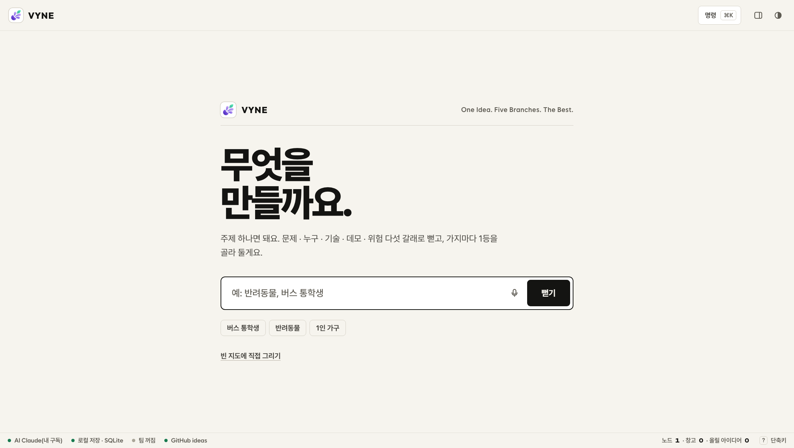

모아 둔 아이디어 0개(아래 줄 '창고 0'). 시작 화면에는 주제 칸 하나만 있다.

## 2. 주제 한 줄 → 다섯 갈래

주제 칸에 **첫 자취방 계약**을 치고 '뻗기'.

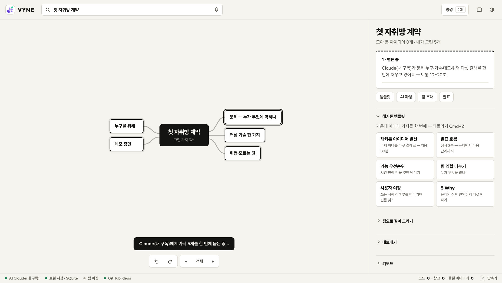

갈래 다섯 개가 먼저 그려지고, Claude 에게 다섯 갈래의 답을 **한 번에** 묻는다(갈래마다 따로 물으면 다섯 배 느리다). 20초쯤 걸렸다.

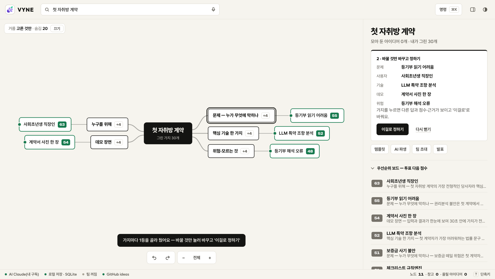

갈래마다 점수 1등이 미리 골라진다. 오른쪽 '바꿀 것만 바꾸고 정하기'에 지금 고른 다섯 개가 보인다:
사회초년생 직장인 · 등기부 읽기 어려움 · LLM 특약 조항 분석 · 계약서 사진 한 장 · 등기부 해석 오류.

## 3. 1등을 그대로 두지 않은 곳 — 핵심 기술

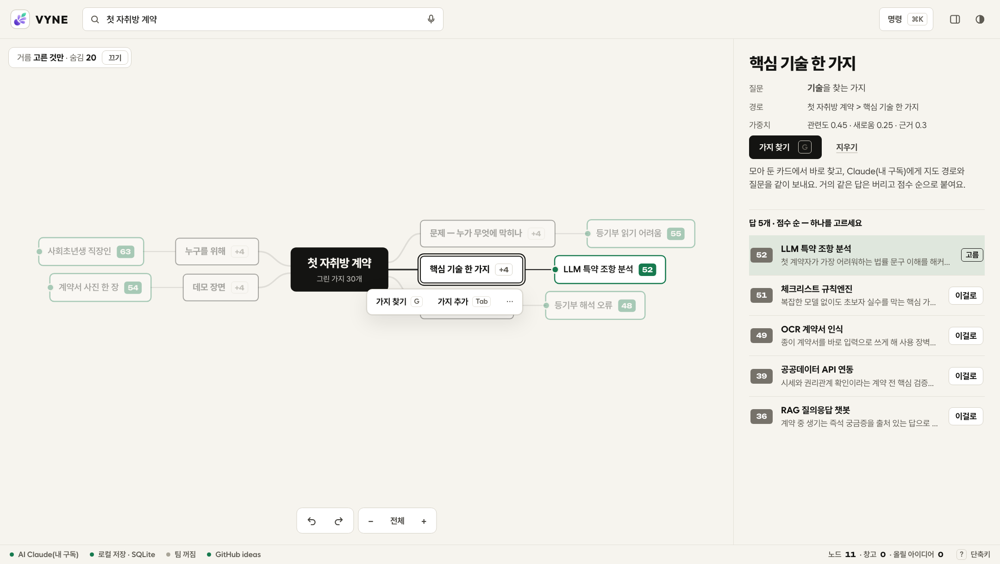

'핵심 기술 한 가지'를 누르면 답 5개가 점수 순으로 보인다. 1등은 **LLM 특약 조항 분석(52)**, 2등은 **체크리스트 규칙엔진(51)** — 1점 차이다.

규칙엔진으로 바꿨다. 이유:

- 사회초년생이 "왜 위험하다는 거지?"를 물을 때, 규칙은 근거를 그대로 보여 줄 수 있다(어느 규칙이 몇 %에서 걸렸는지).
- 등기부에는 이름·주소가 있다. 규칙이면 글을 기기 밖으로 보내지 않고 브라우저 안에서 끝낼 수 있다.
- 바깥 API 비용·키가 없다 — 대회장에서 끊길 게 없다.

기술이 '사진 + LLM'에서 '붙여 넣기 + 규칙'으로 바뀌었으니 데모도 맞춰 **계약서 사진 한 장 → 위험도 신호등(45)** 으로 바꿨다.

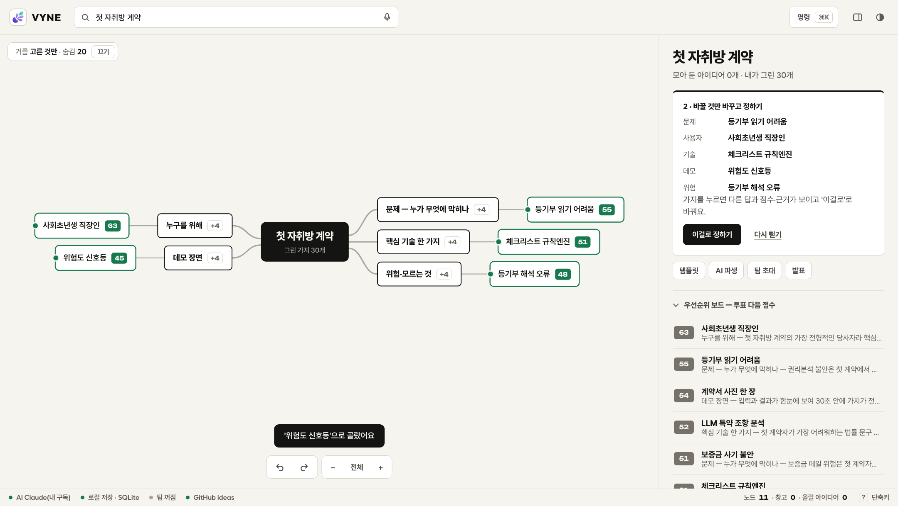

## 4. 이걸로 정하기 — AI 가 안의 칸을 채운다

'이걸로 정하기'를 누르면 고른 다섯 답으로 '정한 안' 카드가 생기고, Claude 가 한 줄 소개 · 문제 · 흐름(입력→처리→출력) · 할 일 · 위험을 채운다.

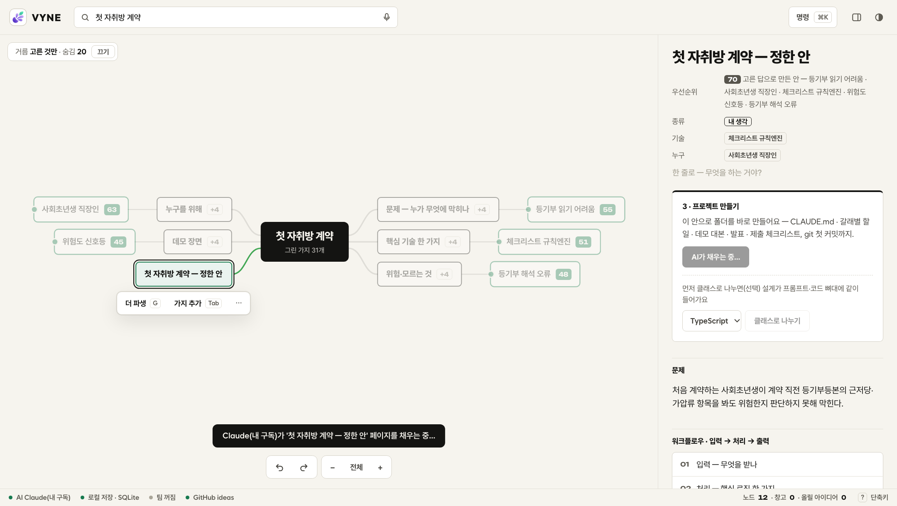

**여기서 처음 걸렸다.** 첫 채우기가 실패했는데, 곧바로 뜬 '정했어요' 알림이 실패 알림을 덮어서 빈 카드만 남았다. 사용자는 왜 비었는지 모른다. → VYNE 를 고쳤다: 채우기가 실패하면 '정했어요' 대신 실패를 알리고, 알림에 **다시 채우기** 단추를 단다. 다시 채우니 14초에 다섯 칸이 채워지고 이름이 **등기체크**로 정해졌다. 실패한 첫 시도가 남긴 같은 안 하나('등기 체크')는 지웠다.

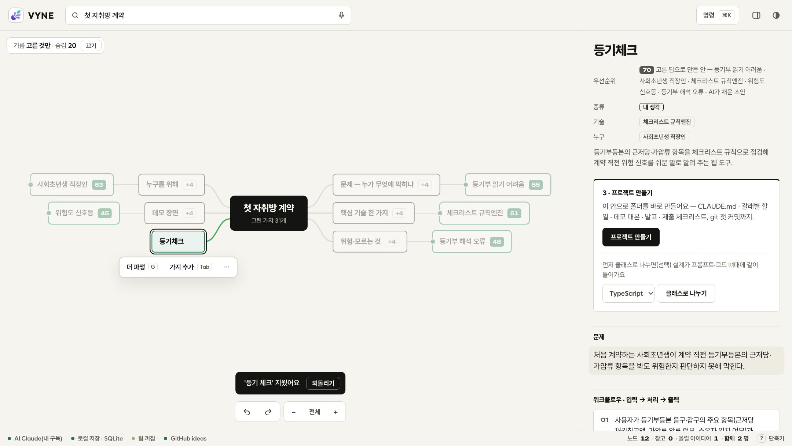

## 5. 사람이 고친 두 칸

AI 가 채운 칸 가운데 두 개는 손으로 고쳤다.

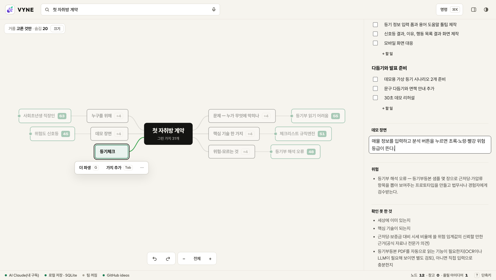

- **흐름 1(입력)** — "항목을 입력한다"를 "등기부등본 글을 통째로 붙여 넣으면 근저당·가압류·소유자를 자동으로 뽑고, **사람이 보고 고칠 수 있다. 글은 기기 밖으로 안 나간다**"로. 처음 계약하는 사람에게 칸을 일일이 채우라고 하면 거기서 멈춘다. 그리고 파서는 틀릴 수 있으니 고칠 길이 있어야 한다.
- **데모 장면** — "분석 버튼을 누르면 초록·노랑·빨강이 뜬다"를 숫자가 있는 장면으로: *샘플 글을 붙여 넣으면 을구 근저당(채권최고액 9천만 원)과 소유자가 뽑히고, 보증금 1억·시세 1억 5천만을 넣고 '확인'을 누르면 '선순위 9천만 + 보증금 1억 = 시세의 127% — 빨강'과 이유, 중개사에게 물어볼 질문이 뜬다.* 이 문장이 나중에 '끝났다는 기준'이 된다.

## 6. 클래스로 나누기

언어를 **JavaScript** 로 고르고(빌드 없이 브라우저에서 바로 열리게) '클래스로 나누기'.

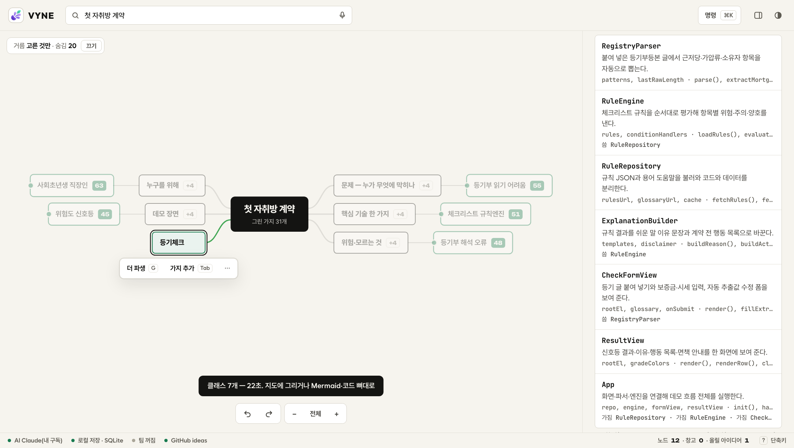

22초에 클래스 7개가 나왔다 — `RegistryParser`(등기 글 읽기) · `RuleEngine`(규칙 평가) · `RuleRepository`(규칙 파일 읽기) · `ExplanationBuilder`(쉬운 말로 풀기) · `CheckFormView` · `ResultView` · `App`. 화면 · 저장 · 핵심 로직을 나눠서 핵심 로직을 화면 없이 시험할 수 있게 한 설계다. 이 설계는 키트의 `docs/DESIGN.md`(그림 포함)와 `core/` 뼈대로 들어간다.

## 7. 창고에 올리기

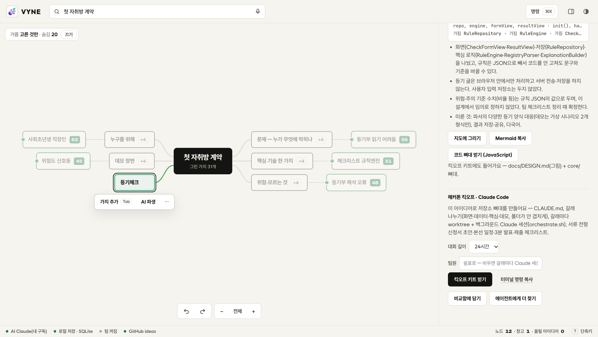

'창고에 올리기'를 누르면 정한 안이 아이디어 은행(GitHub 저장소)에 `ideas/등기체크.md` 와 만들기 프롬프트로 올라간다(이번 기록은 시험용 은행에 올렸다). 아래 '해커톤 킥오프'에서 대회 길이(24시간)와 팀원을 정할 수 있다.

## 8. 프로젝트 만들기

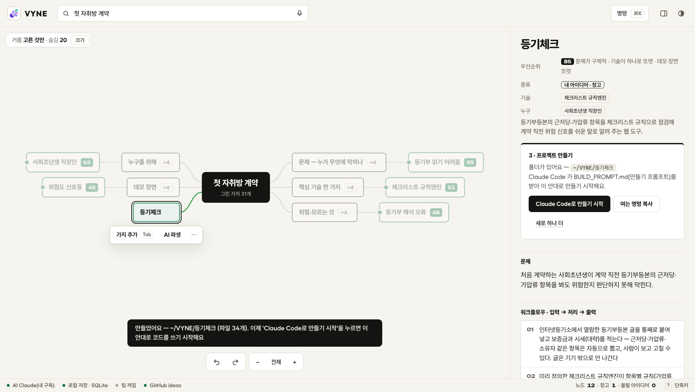

'프로젝트 만들기'를 누르면 `~/VYNE/등기체크` 에 파일 34개와 git 첫 커밋이 생긴다. 들어 있는 것:

- `BUILD_PROMPT.md` — 만들기 지시서(왜 · 흐름 · 끝났다는 기준 · 설계 · 순서 · 위험 · 일하는 방식)
- `CLAUDE.md` — Claude Code 가 폴더를 열면 먼저 읽는 규칙
- `docs/DESIGN.md` · `core/*.js` 뼈대 · `TASKS.md`(갈래별 할 일) · `docs/HACKATHON.md`(신청서 초안 · 일정 · 3분 발표 · 제출 체크리스트)

카드에는 다음 할 일이 바로 보인다: **Claude Code로 만들기 시작**(터미널을 열고 그 폴더에서 `claude "$(cat BUILD_PROMPT.md)"` 를 실행) · **여는 명령 복사**. 이번엔 이미 이 대화가 Claude Code 세션이라 단추를 누르지 않고(세션이 하나 더 뜬다), 같은 `BUILD_PROMPT.md` 를 이 세션에서 그대로 따랐다.

---

## 9. BUILD_PROMPT 대로 만들기

지시서의 '순서'를 그대로 따랐다 — 규칙 설계 → 규칙엔진 → 화면 → 다듬기. 단계마다 시험을 돌리고 작게 커밋했다.

| 커밋 | 한 것 | 확인한 방법 |
|---|---|---|
| 등기 글 파서와 규칙·용어·가상 시나리오 데이터 | 규칙 12개 · 용어 13개 · 지어낸 등기부 4장 · `RegistryParser` | 시나리오 4장을 넣어 뽑힌 값 확인 |
| 규칙엔진·규칙 저장소·설명 만들기와 핵심 시험 14개 | `RuleEngine` · `RuleRepository` · `ExplanationBuilder` | `npm test` 14개 통과 |
| 입력·결과 화면(애플 글라스 결)과 브라우저 데모 확인 | `CheckFormView` · `ResultView` · `App` · 화면 | `npm run demo:check` — 진짜 크롬으로 데모 장면 |
| 결과 뒤에 칸을 고치면 옛 결과로 표시 | 아래 '만들면서 고친 것' | 데모 확인에 항목 추가 |
| README·메모·계약 형식·설계 바꾼 것·CI | 문서 · GitHub Actions | CI 에서 시험 + 데모 확인 |

### 어려웠던 곳 — 등기 글 읽기

인터넷등기소 열람 글을 복사하면 표 칸이 공백 · 탭 · `|` 로 흩어져 온다. 그래서 칸 위치를 믿지 않고:

1. `【 갑 구 】` `【 을 구 】` 제목으로 덩어리를 나누고,
2. 줄 맨 앞 **순위번호 + 등기목적 낱말**(근저당권설정 · 가압류 …)로 항목의 시작을 잡고 다음 항목 전까지 줄을 잇는다.
3. **부기등기**를 본 등기에 합친다 — `1-1 1번근저당권변경`은 1번의 금액을 바꾸고, `1-2 1번근저당권이전`은 권리자만 바꾼다(새 빚이 아니다).
4. `3 2번전세권설정등기말소` 처럼 **말소**가 가리키는 등기를 지운다.

4번 시나리오(맨션)가 이걸 시험한다 — 1억 2천만 근저당이 6천만으로 바뀌고, 이전은 두 번째 근저당으로 세지 않고, 말소된 전세권 · 가압류는 빠진다.

### 끝났다는 기준 — 돌려 본 결과


`npm run demo:check` 가 크롬을 띄워 **빌라 글을 붙여 넣고 → 뽑힌 값(을구 1번 근저당 9천만 · 소유자 한○○)을 확인하고 → `1억` · `1억 5천만` 을 쳐서 → '확인'** 을 누른다. 화면의 머리글이 정확히 `선순위 9천만 + 보증금 1억 = 시세의 127% — 빨강` 인지, 이유와 질문 3개가 뜨는지 본다. 같은 확인에서 휴대폰 폭(390px) 가로 넘침, 누를 곳 크기, 어두운 화면, 빈칸 오류, 용어 풀이, 다른 시나리오 3개도 본다.

### 만들면서 고친 것 — 등기체크 안에서

직접 눌러 보며 걸린 것들:

- **'위험' 바로 밑에 초록 비율** — 신탁 · 가압류 오피스텔은 전체가 '위험'인데, 그 밑에 '시세의 40% — 초록' 상자가 크게 떠서 신호가 엇갈렸다. → 비율 상자는 비율이 빨강 · 노랑일 때만 크게 띄운다.
- **신탁된 집의 '소유자 다름'** — 소유자가 신탁회사면 집주인과 이름이 다른 게 당연한데, 일반 문장("다른 사람 같아요")이 나왔다. → 신탁일 때 따로 규칙: "위탁자는 신탁회사 동의 없이 빌려줄 권한이 없을 수 있어요".
- **결과를 본 뒤 칸을 고치면** 옛 결과가 그대로 남아 새 결과처럼 보였다. → 칸이 바뀌면 결과를 흐리게 하고 "'확인'을 다시 누르세요".
- **고친 칸이 덮어써짐** — 뽑힌 금액을 고친 뒤 등기 글을 조금 고치면 다시 뽑아 사람이 고친 값을 지웠다. → 덮어쓰지 않고 '다시 뽑기'를 묻는다.
- 휴대폰에서 용어 단추가 너무 작았다(손가락으로 못 누름) → 36px 캡슐로. 머리글 `127%— 빨강` 띄어쓰기.

### 스타일

만드는 도중 "스타일은 애플 글라스로"라는 요청을 받아 화면을 **리퀴드 글라스** 결로 바꿨다 — 반투명 유리판(뒤를 흐리게 비침) · 가장자리 빛 · 캡슐 단추 · iOS 시스템 색(신호등 셋 + 파랑 하나) · 설정 앱 같은 묶음 목록. 유리는 뒤에 뭔가 있어야 보여서 옅은 색 번짐을 깔았고, '투명도 줄이기'를 켠 사람에겐 불투명한 판으로 바꾼다.

| 휴대폰 | 어두운 화면 |
|---|---|
|  |  |

---

## 10. VYNE 에서 고친 것 — 직접 써 보며

이 과정에서 사람이 불편할 곳을 찾아 VYNE 쪽을 고친 목록이다.

| 불편 | 고친 것 |
|---|---|
| 정하기를 누르면 AI 채우기가 실패해도 '정했어요'가 실패 알림을 덮음 | 실패를 알리고 알림에 '다시 채우기' 단추 |
| 뻗은 직후 첫 갈래에 초점 테두리가 남아 골라진 것처럼 보임 | 뻗은 뒤 초점을 지도로 |
| "기술 를", "(으)로", "'등기쉽다'을" 같은 조사 | 받침을 보고 을/를 · 으로/로를 고름 |
| 다른 가지를 눌러도 오른쪽 패널이 아래로 내려간 채 | 고른 것이 바뀌면 패널을 맨 위로 |
| 작은 지도(미니맵) · 아래 도구가 가지를 가림, 전체 보기에서 글자가 너무 작음 | 미니맵은 오른쪽 아래로, 화면 맞춤 때 도구 자리를 비우고 글자가 읽히는 크기 아래로는 안 줄임 |
| 고른 가지의 테두리가 두꺼워지며 글자가 잘림 | 테두리 대신 그림자 고리로 |
| 프로젝트를 만든 뒤 다음에 뭘 하는지 없음, 경로가 `/Users/…` 전체 | 'Claude Code로 만들기 시작' · '여는 명령 복사', 경로는 `~/VYNE/…` |
| AI 가 고른 기술(규칙엔진)이 아닌 LLM 을 칸에 끼워 넣음 | 채우기 지시에 '고른 기술을 핵심으로, 없는 LLM · 유료 API 를 새로 끌어들이지 않기' |
| 창고 첫 커밋이 "고침: 아이디어 0장", 지운 것도 '고침'으로 셈 | 올림 · 뺌 · 고침을 나눠 셈 |
| (만들면서) 신청서 초안 '해결 방법' 칸이 글자 중간에서 잘림("…뽑고, 사 →") | 낱말 사이에서 끊고 '…', 흐름은 첫 마디만 |
| (만들면서) '세상에 이미 있는지' 같은 틀의 빈말이 AI 가 진짜 항목을 채운 뒤에도 CLAUDE.md 까지 따라감 | 진짜 항목이 오면 틀의 빈말을 빼고, 키트에서도 거름 |
| (만들면서) 첫 커밋 작성자가 'VYNE' | 내 git 이름으로 커밋(이름이 없는 컴퓨터에서만 VYNE) |

고친 뒤 VYNE 시험: 파이썬 140개 · 화면 핵심 31개 · 브라우저 73개 통과, GitHub CI 통과.

## 따라 하려면

- **등기체크만** — 이 저장소를 받아 `npm start` → `http://localhost:8080/app/`. 데모는 `?demo=villa`.
- **같은 방식으로 다른 앱** — 이 저장소의 [`BUILD_PROMPT.md`](../BUILD_PROMPT.md) 가 지시서의 모양이다. 왜 · 사용자 흐름 · 끝났다는 기준(숫자가 있는 한 장면) · 설계 · 순서 · 위험 · 일하는 방식을 채워 Claude Code 에게 건네면 된다. 핵심은 **'끝났다는 기준'을 숫자가 있는 장면으로 쓰고, 그 장면을 자동으로 돌려 보는 확인을 먼저 만드는 것**이다.
- VYNE 자체는 아직 공개 전이다(공개된 건 아이디어 지도 보기 화면 <https://zmflm0110.github.io/vyne/> 뿐).
